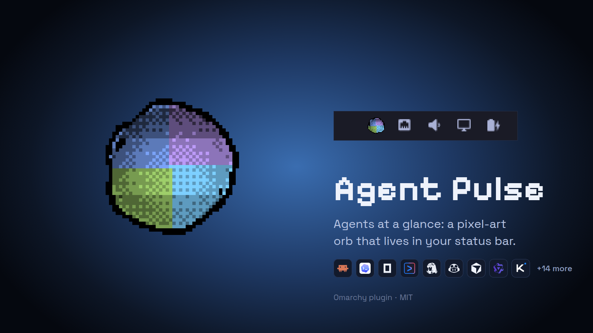

<h1 align="center">Agent Pulse</h1>

<p align="center">See at a glance which of your AI coding agents is working.</p>

<p align="center"></p>

## What it does

A pixel-art orb for the [Omarchy](https://omarchy.org) status bar that watches
every AI coding agent session and shows which one is working.

- Watches 23 coding agents and detects the ones you have installed
- The orb spins only while something is in flight, and each active agent gets its own band of colour
- Hover for the list of detected agents, busy ones first
- Colours follow the active Omarchy theme
- Pairs with [`OmarchyAgentOrb`](https://github.com/macd2/OmarchyAgentOrb), a floating version of the same orb. Each works with or without the other

## Install

```bash
omarchy plugin add https://github.com/macd2/OmarchyAgentOrbStatus --enable
```

Updates are just:

```bash
omarchy plugin update io.github.macd2.agent-pulse
```

Copied the folder instead? `./scripts/install.sh` does the same thing by hand,
and `--watch` symlinks it so edits hot-reload.

## Using it

- **hover** — every detected agent with an event count, busy ones first
- **click** — toggles the floating orb (requires
  [`OmarchyAgentOrb`](https://github.com/macd2/OmarchyAgentOrb))
- **middle click** — rebroadcasts a state reload across every monitor

## Agents

The watcher ships with 23 agents — opencode, claude, codex, hermes, pi, gemini,
antigravity, qwen, kimi, grok, copilot, goose, crush, aider, amp, cursor,
kilocode, continue, openhands, plandex, vibe, junie, openclaw — auto-detected,
and extensible without editing code:

```bash
# ~/.config/omarchy/agent-watch/sources.json
{"extra":[{"id":"myagent","label":"My Agent","dirs":["~/.myagent/sessions"]}]}

# or ad-hoc
AGENT_ORB_SOURCES="myagent=~/.myagent/sessions"
```

The watcher is a singleton behind a pid lockfile and is shared with
`OmarchyAgentOrb`: whichever plugin starts first owns the process, and the
other adopts it rather than respawning against the lock. Both work with or
without the other.

## Requirements

- Omarchy with `omarchy-shell` (extends `BarWidget`, uses `BarIconButton`)
- Node 20+ for **recursive** `fs.watch` on Linux; Node 18 degrades to
  top-level-only watching
- `jq`, for `scripts/install.sh` only

## If something looks wrong

- **Agents working in nested project folders are not picked up.** On Node 18,
  `fs.watch` is not recursive on Linux and only watches top-level folders.
  Install Node 20+.
- **Only one watcher process runs.** The watcher is shared with
  `OmarchyAgentOrb`: whichever plugin starts first owns the pid lockfile and the
  other adopts it. That is expected, not a fault.

## How it works

It is the same idea as
[`OmarchyAgentOrb`](https://github.com/macd2/OmarchyAgentOrb) — a
noise-displaced sphere with a 4-colour iridescent gradient — rebuilt for a 23 px
slot:

| floating orb | bar version |
|---|---|
| mesh lines | one pixel at a time |
| bilinear colour blend | hard nearest pick of the four anchors |
| smooth shading | 5 levels, 4×4 Bayer dither |
| 480 stroke draws | ~20 paths of 1×1 fillRects |

The sphere is cut into four horizontal bands. Bands are assigned **by recency**,
not to fixed agents, so a live agent never loses its band to an idle one that
happened to write a second ago. Busy sources outrank merely-recent ones.

### The hard part: knowing when work is actually happening

The obvious implementation is wrong in both directions.

Profiling opencode for 60 s showed **60 of 66 events were `opencode.db-wal`** —
SQLite checkpoints that fire whether or not the agent is doing anything. Treating
any write as work pinned the orb into permanent motion.

Filtering the sidecars fixed that but overshot: opencode writes session state at
turn boundaries and is silent while tools run, so the orb barely moved during
real work.

A second 45 s profile resolved it. The sidecar writes are **bursty**:

```
idle:     wal= 0  wal= 0  wal= 0  wal= 0
working:  wal= 0  wal=34  wal= 0  wal=12
```

So they were the best signal available and were being thrown away. They are no
longer filtered. Instead `busy` requires either a real (non-sidecar) file within
2.5 s, or a burst of 3+ events within 1.5 s — which rejects stray noise while
keeping the bursts.

Measured: **91 % busy while working, 0 % while idle.**

Motion is gated on that tight signal while the band glow decays over 6 s, so the
orb spins only while something is in flight instead of vibrating after every
message.

## Remove

```bash
omarchy plugin remove io.github.macd2.agent-pulse
```

That deletes the plugin, disables it, removes it from the bar and reloads the
shell. The watcher is a child of the shell process, so it exits with it —
nothing is left running.

This widget ships its own copy of the watcher but only ever *one* process runs:
whichever plugin starts first owns the pid lockfile and the other adopts it.
Removing this plugin therefore does not stop the watcher if the orb is still
enabled. To remove both, remove the orb as well.

Nothing outside `~/.config/omarchy/plugins/` and the shared state directory is
touched. This plugin writes no configuration of its own.

## License

MIT
